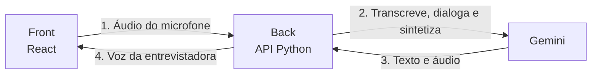
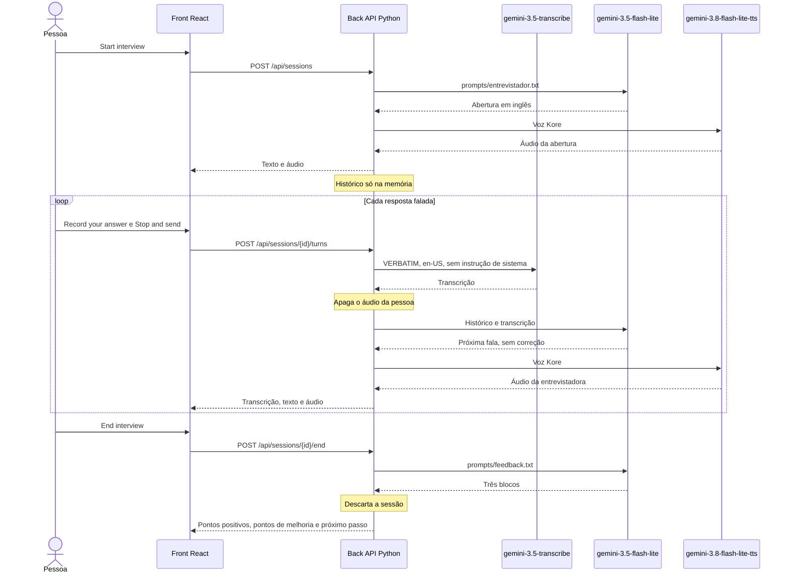

# poc-en-simulator

Prova de conceito local de um simulador de conversação em inglês por voz, no cenário de entrevista de emprego em tecnologia.

A Sprint 1 fecha o que será construído. A Sprint 2 implementa o fluxo na máquina local. A sessão-piloto está em `docs/sprint-3/registro-sessao-piloto.md`, com os quatro turnos reconhecidos. A nota de privacidade está em `docs/sprint-3/nota-de-privacidade.md`. O DAS na versão 1 e a publicação em nuvem seguem pendentes.

| Entrega da Sprint 1 | Arquivo |
|---------------------|---------|
| Lista de requisitos do fluxo único | `docs/sprint-1/requisitos-do-fluxo.md` |
| Combinação tecnológica | `docs/sprint-1/combinacao-tecnologica.md` |
| Instruções de sistema | `docs/sprint-1/instrucoes-de-sistema.md` e `prompts/` |
| DAS parcial | `docs/sprint-1/das-parcial.md` |

## Como funciona

A pessoa fala no navegador. A API local pede ao Gemini a transcrição, a próxima fala e a voz, e devolve isso ao navegador. O histórico fica só na memória da API. O áudio da pessoa é apagado ao fim do turno. A correção aparece só no encerramento, em três blocos.



A sequência abaixo é o mesmo caminho, com cada chamada.



## Como rodar na máquina local

A chave `GEMINI_API_KEY` fica só no ambiente do processo. Não entra no repositório, no navegador nem em arquivo versionado.

```bash
cd /home/luiz-victor/dev/poc-en-simulator
python3 -m venv .venv
.venv/bin/pip install -r requirements.txt
export GEMINI_API_KEY="a chave, sem aspas no arquivo versionado"
cd web && npm install && cd ..
scripts/run-local.sh
```

A interface abre em `http://127.0.0.1:5173`. A API escuta em `http://127.0.0.1:8765`. O único cenário é “Entrevista de emprego — Tecnologia”.

Cada turno envia o áudio do microfone à API local. A API chama reconhecimento, diálogo e síntese na mesma requisição e devolve o texto da entrevistadora com o áudio correspondente. Ao encerrar, uma segunda chamada gera o retorno em três blocos. O histórico textual permanece só em memória. O áudio da pessoa é descartado ao fim do turno.

O teste curto da Sprint 1 ainda está em `scripts/sprint-1-voice-check.py`. O procedimento está na seção 4 de `docs/sprint-1/combinacao-tecnologica.md`. O primeiro turno real da Sprint 2 está em `docs/sprint-2/resultado-primeiro-turno.md`.
