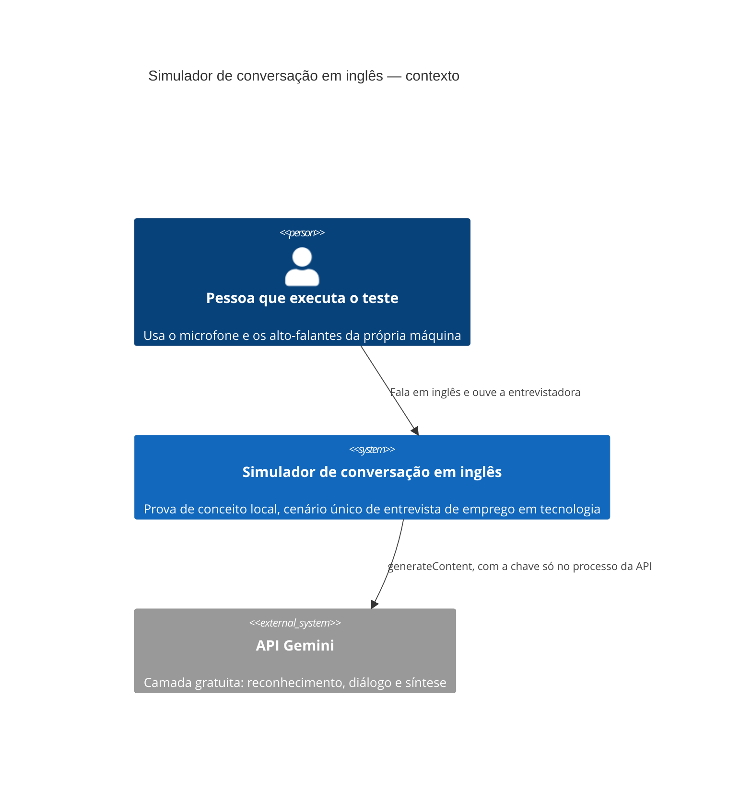
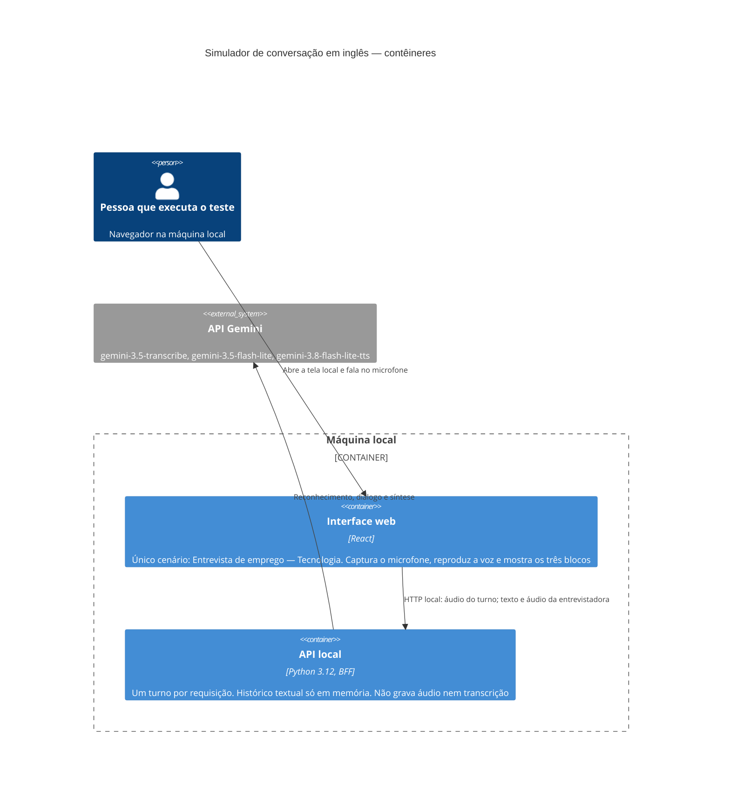
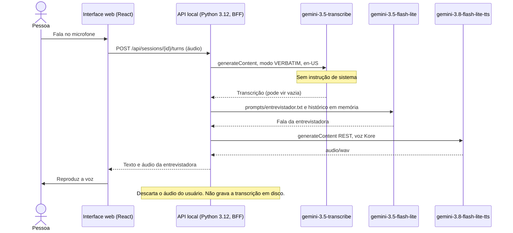

# Documento de Arquitetura de Software — parcial

**Projeto:** Simulador de Conversação em Inglês com Inteligência Artificial  
**Sprint:** 1 — Base do fluxo e escolha da tecnologia  
**Card:** [issue 4](https://github.com/fsluizvictor/poc-en-simulator/issues/4)  
**Versão:** 0.2 — parcial  
**Data:** 10 de novembro de 2026  
**Atualização dos diagramas:** 15 de novembro de 2026 (Sprint 2, [issue 8](https://github.com/fsluizvictor/poc-en-simulator/issues/8))

Este documento descreve o contexto da prova de conceito local, as premissas e as restrições. Os diagramas de contexto, de contêineres e de sequência de um turno foram incorporados na Sprint 2, neste mesmo arquivo. O resultado da sessão-piloto e a nota de privacidade fechada entram na Sprint 3. Esta versão descreve o fluxo local; não afirma que a sessão-piloto de cinco a dez minutos já ocorreu.

## 1. Contexto

A prova de conceito é um simulador de conversação em inglês por voz. A inteligência artificial atua como entrevistadora em um único cenário: entrevista de emprego na área de tecnologia. O artefato valida se esse fluxo é percorrível na máquina local. Não é produto comercial nem curso de idiomas.

Quem usa a sessão-piloto é a própria pessoa que executa o teste, no computador em que a interface e a API estão rodando. Não há amostra externa nesta versão.

O sistema conversa com um provedor externo, a API Gemini, na camada gratuita. A aplicação local não guarda a fala depois do turno. O provedor, nessa camada, pode usar o conteúdo enviado para melhoria dos próprios produtos (GOOGLE, 2026). Por isso a sessão usa apenas a voz de quem executa o teste.

## 2. Contexto e contêineres (C4)

A prova de conceito tem dois contêineres locais e um sistema externo. Não há banco de dados, fila nem canal bidirecional contínuo.

| Contêiner | Responsabilidade | Tecnologia escolhida |
|-----------|------------------|----------------------|
| Interface web | Mostrar o cenário único, capturar o microfone, reproduzir a voz da entrevistadora e exibir os três blocos ao encerrar | React, executado na máquina local |
| API local | Receber o áudio do turno, chamar reconhecimento, diálogo e síntese em sequência, devolver texto e áudio, e guardar o histórico só em memória. A chave do modelo fica neste processo | Python 3.12, no padrão *Backend for Frontend* (BFF) |
| Provedor de fala e diálogo | Transcrever, gerar a próxima fala e sintetizar a voz | API Gemini, camada gratuita |

O turno é síncrono: reconhecimento, modelo e síntese ocorrem em sequência dentro da mesma requisição HTTP local.

### 2.1 Diagrama de contexto

### 2.2 Diagrama de contêineres

## 3. Fluxo de um turno

1. A interface envia à API local o áudio recém-capturado.
2. A API envia esse áudio ao modelo `gemini-3.5-transcribe`, em modo literal, e recebe o texto.
3. A API envia a instrução da entrevistadora e o histórico em memória ao modelo `gemini-3.5-flash-lite`, e recebe a próxima fala.
4. A API envia essa fala ao modelo `gemini-3.8-flash-lite-tts` e recebe o áudio.
5. A API devolve texto e áudio à interface e descarta o áudio do usuário.
6. O histórico textual permanece apenas no processo, até a sessão terminar.

No encerramento, a mesma API faz uma segunda chamada a `gemini-3.5-flash-lite`, com a instrução de retorno, e devolve os três blocos. Essa chamada não passa pelo reconhecimento nem pela síntese.

### 3.1 Diagrama de sequência de um turno

## 4. Premissas

As premissas vêm do escopo fechado. Se uma delas for falsa, o efeito está na coluna ao lado.

| ID | Premissa | Efeito se for falsa |
|----|----------|---------------------|
| P-01 | A sessão-piloto dispõe de microfone funcional, de internet estável e de um computador capaz de executar a interface e a API localmente | Sem microfone ou rede, o fluxo de voz não é demonstrado |
| P-02 | Permanece acessível, durante as três sprints, uma oferta gratuita de reconhecimento, modelo de linguagem e síntese | Se o serviço gratuito não reconhecer a fala a ponto de o diálogo continuar, a sessão-piloto não completa os quatro turnos e a limitação fica registrada neste documento |
| P-03 | Cinco a dez minutos bastam para percorrer o fluxo | Se o fluxo não couber nesse intervalo, o critério mensurável do objetivo não se completa |
| P-04 | A sessão é uma simulação, distinta de uma entrevista real | Se for conduzida como entrevista real, o ensaio deixa de ser prática de baixa pressão |

Observação de ambiente, em 10 de novembro de 2026: o computador da prova de conceito expõe um dispositivo de captura, ALC257 Analog, placa 1, dispositivo 0. O teste curto dessa data gerou diálogo e áudio sintetizado. A transcrição veio vazia: o microfone não captou uma frase falada. O reconhecimento de sotaque brasileiro segue sem evidência.

## 5. Restrições

| ID | Restrição |
|----|-----------|
| RC-01 | O prazo é de 21 dias corridos, de 2 a 22 de novembro de 2026, em três sprints de sete dias |
| RC-02 | O orçamento é nulo. Somente camada gratuita e ferramentas sem custo |
| RC-03 | A prova de conceito é executada localmente. A publicação em nuvem não é condição para concluir o objetivo |
| RC-04 | A aplicação não armazena áudio nem transcrição após o turno |
| RC-05 | Há um único cenário |
| RC-06 | A correção ocorre somente ao final |
| RC-07 | A entrega não inclui afirmação de ganho de fluência |
| RC-08 | A chave do modelo não entra no navegador |
| RC-09 | A sessão-piloto utiliza apenas a voz de quem executa o teste, porque a camada gratuita pode usar o conteúdo enviado para melhoria dos produtos do provedor |

## 6. Decisões já tomadas

O detalhe e as fontes estão em `docs/sprint-1/combinacao-tecnologica.md`.

- Interface em React.
- API local em Python 3.12.
- Um único provedor, a API Gemini, com três modelos da camada gratuita: `gemini-3.5-transcribe`, `gemini-3.5-flash-lite` e `gemini-3.8-flash-lite-tts`.
- Transcrição no modo literal, para não apagar hesitações antes do retorno.
- A API em tempo real de áudio contínuo (*Live API*) não será usada. Conversa contínua por canal bidirecional está fora do escopo.

## 7. O que esta versão ainda não contém

- registro da sessão-piloto de cinco a dez minutos;
- nota de privacidade fechada, prevista como entrega própria da Sprint 3;
- DAS na versão 1 após a sessão-piloto.

Os diagramas de contexto, de contêineres e de sequência de um turno estão nas seções 2 e 3. O código da interface e da API do turno pertence à Sprint 2 e não reabre as entregas da Sprint 1. O teste de 10 de novembro de 2026, em `docs/sprint-1/resultado-teste-voz.md`, não contém fala reconhecida e não é evidência de reconhecimento de sotaque brasileiro.

## 8. Referência

GOOGLE. Gemini API: pricing. 2026. Disponível em: https://ai.google.dev/gemini-api/docs/pricing. Acesso em: 10 nov. 2026.
